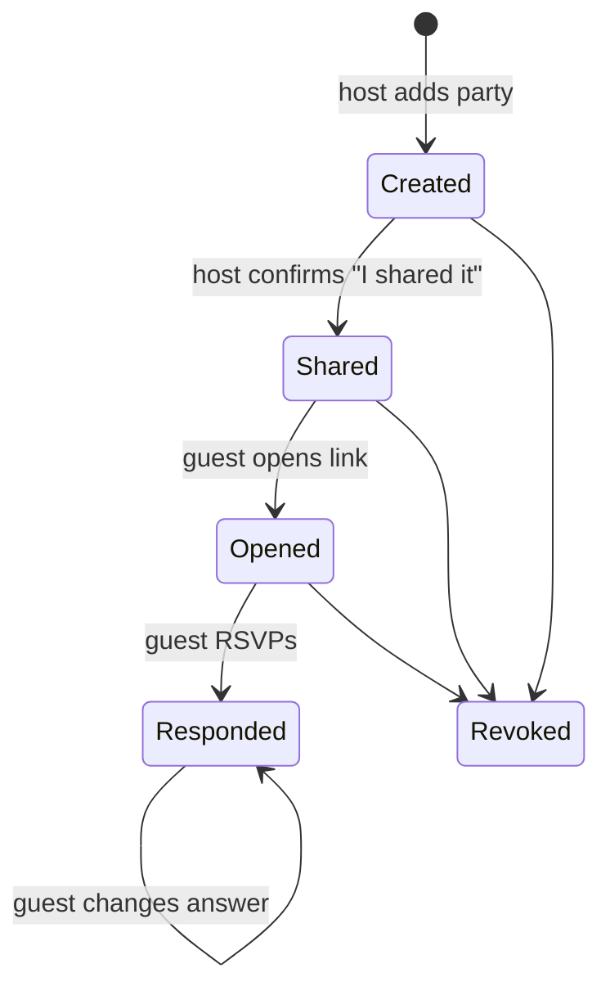
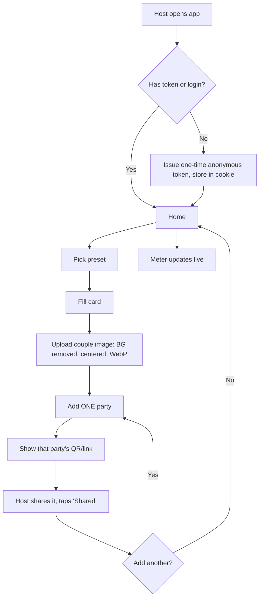

# InviteMe: Version 1 Product Spec

Status: draft 2 (decisions from review applied). Sources: `docs/app-flow-human.md`, template image `docs/invite-v1-01.png`, and the scoping answers.
**[Assumption]** = my interpretation, change if wrong. **[Open]** = needs your answer (section 16).

---

## 1. Summary

InviteMe lets a couple build a wedding invitation from a designed preset, define exactly who is invited (single, couple, or group), and send each guest party a **personal QR/link**. Guests see only the couple's invitation with no InviteMe branding except a small footer. The couple sees live progress on a large meter on their home screen.

v1 ships **one preset** (Traditional Golden Caller), **weddings only**, **English + Sinhala**, mobile first. The system is built around an *event type* so birthdays can be added later without a rewrite.

### Goals

- A couple goes from nothing to a shareable invite in minutes, on a phone, without an account.
- Every guest party has its own unguessable link showing only what concerns them (invited as, seat, rules).
- The invite feels alive: metallic gold foil, appearing and morphing animations, colour morph.
- The host sees in real time who opened and who is coming.
- **Everything is stored in Durable Objects**: one per person (party), plus per-event and per-host objects. Invitation data has no SQL. Auth (Better-Auth) stays on the existing D1 database (`packages/db`); see 16, Q1.

### Non-goals for v1

- Birthdays or other event types (the model supports them; no UI or presets).
- Hotel integrations, maps, venue partnerships.
- Scoreboard between couples.
- Payments, plans, monetisation.
- Messenger integrations (WhatsApp/Messenger/Telegram/Facebook). See 4.5.
- Bulk guest import. Guests are created one by one.
- Heart-shaped couple image composition (dropped to reduce complexity, see 9).
- Preset marketplace or visual preset editor.

---

## 2. Users and roles

| Role | Who | Auth | Can do |
| --- | --- | --- | --- |
| **Host** | Bride and/or groom | Anonymous token **or** logged-in account | Create/edit event, fill card, create parties, view meter, get per-party QR/link |
| **Guest** | A person invited, represented as a *party* | None; the personal link is the credential | View the invitation, see own details, RSVP |

"Home" is the host's surface and the most used. The guest surface is a public, branding-free page.

---

## 3. Core concepts

| Concept | Meaning |
| --- | --- |
| **Event** | One wedding. Has `eventType` (`wedding` in v1; `birthday` later), a preset, and all card data. |
| **Preset** | A self-contained design package: card, guest-list config screens, assets. First: `Traditional Golden Caller`. |
| **Party** | The invitation unit: `single` (1 seat), `couple` (2 seats), or `group` (N seats, host-set). |
| **Invite link** | Unique, unguessable URL + QR for exactly one party. |
| **Open** | A party's link was opened and the card rendered. |
| **RSVP** | `yes`, `maybe`, `no`, `pending`. A `yes` always carries a **head-count given by the guest**. |
| **Meter** | Host-home gauge (6.2). |

### Party lifecycle



`Shared` is self-reported by the host (the app cannot see what happens outside it).

---

## 4. Host flow



### 4.1 Home

- Large **meter** at the top (6.2).
- Below: the event, preset in use, quick actions: edit card, add guest, guest list, preview.
- v1 has one preset, so the picker is a single card but built as a list.
- Later: scoreboard against other couples. Not built in v1.
- **[Assumption]** one event per host in v1.

### 4.2 Access: anonymous and logged in

**Anonymous**
- On first visit the server issues a **host token**: random, ≥128 bits, **issued once and never regenerated or re-shown** ("non-repeatable").
- Stored in an `HttpOnly; Secure; SameSite=Lax` cookie with a long expiry.
- The host can **export** the token as a link (`/h/<token>`) to reopen on another device or after clearing cookies. Opening it re-sets the cookie.
- It is a bearer secret: the export screen warns "anyone with this link can edit your invitation"; it is never logged.
- If cookie and exported link are both lost, access is lost. The UI says so when the token is issued.
- No later claim by email in v1. **[Assumption]**

**Logged in**
- Event ownership tied to a user, usable across devices without export links.
- **[Open]** Better-Auth in the repo expects a SQL store; with no database this needs a decision (see 16, Q1).

### 4.3 Card editor (Traditional Golden Caller)

Fields come from the template image and notes. All text is translatable (11).

| Section | Field | Image example | Notes |
| --- | --- | --- | --- |
| Hosts | Family line 1 | `MR. XXX & MRS. XXXX` | |
| | Connector | `TOGETHER WITH` | Editable, translatable |
| | Family line 2 | `MR. & MRS. XXXX` | |
| | Request line | `WARMLY REQUEST THE HONOR OF YOUR PRESENCE` | |
| Occasion | Occasion line | `ON THE OCCASION OF THE MARRIAGE OF THEIR CHILDREN` | |
| Couple | Name 1, Name 2 | `BINURI` / `SAMEERA` | Joined by "AND" |
| | Couple image | (not in template image) | See 9 |
| Date | Date | `JANUARY 24 SATURDAY 2026` | One date; month/weekday derived and localised |
| Time | From, To | `9.30 AM TO 2.30 PM` | |
| | Sub-events (optional, repeatable) | `PORUWA CEREMONY AT 9.00 AM` | Label + time |
| Venue | Venue name | `THE KINGSBURY` | "Hotel {specific place name}" |
| | City | `COLOMBO` | |
| RSVP | Contacts (1–N) | `BINURI - 077 1234 567` | Name + phone; tap-to-call |
| Rules | Special rules | e.g. "No whites" | Event-wide, shown to all guests |

Live preview updates as the host types.

### 4.4 Adding guests (one by one)

Guests are created **one at a time**, as a short flow. There is no bulk import and no multi-row table entry.

1. **Add guest**: display name (how the card greets them).
2. **Invited as**:
   - `single`: "you" (1 seat)
   - `couple`: "you + 1" (2 seats)
   - `group`: "you all", host enters the **number of seats** (so totals are trackable)
3. Optional: seat label / hall / room; party-specific rules/notes; default language.
4. **Share screen** shows this party's QR and link (4.5).
5. Host shares it, then taps **"I shared it"** → party becomes `Shared`, and the flow returns to a fresh "Add guest" screen.

The guest list (home) shows every party with its status, seats, and RSVP. Shared parties remain visible and their QR stays retrievable; the "one by one" rule limits creation, not later viewing. **[Assumption]**

### 4.5 Sharing

Sharing is **QR-only**. No messenger integration.

- The share screen shows the party's **personal QR** and link, with: "Send this to *Name*. Only they should use it."
- Actions: copy link, save QR as image, "I shared it".
- A QR can be **revoked** (and a new one issued). The old link then shows the neutral "no longer available" page.
- The QR encodes only the invite URL, no personal data.

---

## 5. Guest flow

1. Guest scans/opens `/i/<partyToken>`.
2. The Worker routes to that party's Durable Object (8.2) and verifies the token. Unknown/revoked shows "This invitation is no longer available".
3. **Opening animation** plays (7.2). Skippable; honours `prefers-reduced-motion`.
4. **Card** renders with the guest's details.
5. The guest sees **their own information** (5.1) and the RSVP control.
6. The open is recorded (6.1).

### 5.1 What a guest sees about themselves

- Invited as, and seat count.
- Venue, date, from/to times, sub-events.
- **Seat label** (hall/room) if set.
- **Rules** (event-wide + party-specific), e.g. "No whites".
- RSVP: `yes` (must enter **how many** are coming, ≤ allotted), `maybe`, `no`. Changeable until the host closes responses (not in v1).
- Contact numbers.

A guest never sees other parties, totals, or the dashboard.

### 5.2 Branding

- No InviteMe branding in the invitation.
- Bottom-most footer only: **InviteMe** and, in the **left corner**, **Built by Tenu22**, both small.
- Guest pages are `noindex`. Link-preview (OG) tags use the couple's names and date, not InviteMe copy.

---

## 6. Tracking, RSVP, meter

### 6.1 Open tracking

- One **Durable Object per party** holds live state: open count, first/last opened, RSVP, head-count.
- On open the party DO updates itself, then notifies the event DO (6.3).
- Link-preview crawlers must **not** count: an open is counted only after a real client runs JS and the card renders. **[Assumption]**
- Stored: timestamps, coarse device class. No IP storage. **[Assumption]**

### 6.2 Meter (host home)

- **Headline**: seats **confirmed** (`yes` head-counts) out of seats allotted, as a large gauge.
- **Opened mark**: on the same gauge, a marker/tick shows how much of the guest list has **opened** (seats of parties opened ÷ allotted), so the host sees opened-but-not-yet-confirmed.
- Secondary counts: `maybe`, `no`, shared-but-not-opened, not shared.
- Updates live while the page is open (WebSocket from the event DO; short polling fallback).

### 6.3 Aggregation

The **event DO** keeps counters (updated by each party DO) and fans out to the host's open dashboard. Party DOs are the source of truth; the event DO can rebuild its counters by asking the parties. **[Assumption]**

---

## 7. Preset 1: Traditional Golden Caller

Reference: `docs/invite-v1-01.png`.

### 7.1 Visual design

- Cream textured paper; gold foil mandala across the top centre and two corner mandalas at the bottom; gold border frame.
- Light serif / small-caps type; names and venue in gold, supporting text charcoal.
- Centred single column; thin divider rule between hosts and occasion.
- Date block: `MONTH — DAY — WEEKDAY` with large day numeral and year beneath.
- The couple image sits between the occasion line and the names. **[Assumption]** (the template image has no photo slot, so the slot is added.)

### 7.2 Motion

Per the template: **appearing** and **morphing** animations plus a **colour morph**; opening/closing; reflection and metallic foil.

- **Appearing**: sections fade/rise in on open and on scroll.
- **Morphing**: ornaments (mandala segments, divider rules, date frame) morph shape as sections appear.
- **Colour morph**: palette shifts (paper warmth, gold tone) across open/scroll.
- **Open / close**: the card opens on entry and can be closed and reopened by tap.
- **Metallic / reflection**: moving specular sheen on gold elements, driven by scroll and, where permitted, device tilt.

Constraints:

- Heavy effects are acceptable for the first design; performance is tuned afterwards (14).
- `prefers-reduced-motion`: static card, minimal fade.
- Static CSS fallback if WebGL/canvas is unavailable.

### 7.3 Preset package layout

Presets are isolated: **no shared pages between presets**; each owns its pages.

```
presets/
└── traditional-golden-caller/
    ├── card/                  # Card schema, translatable defaults, guest-facing pages
    │   ├── schema.ts
    │   ├── copy.en.ts
    │   ├── copy.si.ts
    │   └── pages/
    ├── guest-list/            # Host config screens unique to this preset
    │   ├── schema.ts
    │   └── screens/
    └── assets/
        ├── components/        # Static components
        ├── live/              # Live components (foil, sheen, meter widgets)
        ├── animations/        # Each animation separated
        └── pages/             # Pages separated
```

A preset registers via a typed contract: name, supported event types, card schema, guest-list schema, entry components.

---

## 8. Storage: D1, scoped per client

Invitation data lives in the existing **D1** database (`packages/db`, Drizzle), with auth unchanged. A Durable Object design (one `ClientDO` per client) was tried first. Its runtime could not be run locally: `alchemy dev` needs `CLOUDFLARE_API_TOKEN`, and the OAuth profile is not accepted in its place. Per the user's instruction, v1 moves to D1. Both designs isolate data by `clientId`, so a later move is a per-client export.

### 8.1 Tables

Every table carries `client_id`. Every query is built from the verified token's `client_id`, never from a request field alone.

| Table | Key | Holds |
| --- | --- | --- |
| `clients` | `id` | optional `user_id` (unique; the host's login), created_at. No stored secret |
| `events` | `id`, `client_id` | eventType, preset, card content per locale, counters, couple image key |
| `parties` | `id`, `client_id` | displayName, invitedAs, seats, seatLabel, rules, locale, shared/revoked, opens, firstOpenedAt, lastOpenedAt, rsvp, confirmedSeats. No stored secret: the link secret is HMAC-SHA256(`INVITE_LINK_KEY`, `clientId:partyId`) |

Indexes: `parties(client_id)`, `events(client_id)`. The host dashboard and meter are a few indexed reads per client.

### 8.2 Routing and tokens

Tokens carry the routing key, so lookups are by primary key:

- Host link: not in v1 scope yet. Host access is the signed-in `user_id` → `client` row; a host link secret, if added, derives from `INVITE_LINK_KEY` the same way.
- Party link: `/i/<clientId>/<partyId>.<secret>` → `parties` row `partyId` where `client_id = clientId`, recomputes the HMAC and compares in constant time. The QR is rebuilt from the list at any time. Revoke = mark the row revoked; the row and its history stay. Rotating `INVITE_LINK_KEY` invalidates every link.
- `clientId`/`partyId` are random (not sequential).
- Logged-in listing (user → clients) uses `clients.user_id`. **[Open]** see Q1.

### 8.3 Retention

Data is **kept indefinitely** (no automatic deletion, no expiry). Only the host's revoke removes access to a link. Growth is bounded by guest count per wedding, so storage cost is small. A host-initiated "delete event" is not in v1. **[Assumption]**

### 8.4 Image storage

- The processed WebP goes to an **R2 bucket**, not a D1 row. D1 row/blob size limits make a WebP risky **[Inference: verify exact limit]**. Only the object key is stored in `events`.
- Guests load it from a Worker route (`/a/<eventId>/couple.webp`) with long-cache headers.
- Storage sits behind an `AssetStorage` interface (R2 implementation). **[Inference: verify Alchemy R2 binding]**

### 8.5 API surface (oRPC, `packages/api`)

- Host: `host.issueToken`, `host.exportLink`
- Event: `event.create / get / update`, `event.content.set(locale)`
- Asset: `asset.uploadCoupleImage` (async, status polling)
- Party: `party.create / update / list / markShared / revoke`
- Meter: `meter.get` + live subscription
- Guest (public): `invite.resolve`, `invite.recordOpen`, `invite.rsvp`

`packages/db` (Drizzle) holds the invitation tables above, plus auth tables. **[Open]** see Q1.

---

## 9. Couple image pipeline

> **Removed.** Cards are picture-free; there is no couple image, upload route, R2 bucket, or background-removal dependency. The text below is kept only as history.

Simplified: **remove the background and centre the subject**. No heart composition.

1. Validate type (JPEG/PNG/WebP) and size in the browser. The picker excludes HEIC; iOS converts HEIC to JPEG when a file is picked.
2. **Remove background in the browser** with `@imgly/background-removal` (open-source ONNX model, `small` model, PNG output with alpha). The host sees a progress bar (model download, then removal) while it runs. No server-side cutout service: the Worker never sees the original photo. The model and WASM are fetched from the library's default CDN on first use.
3. **Centre** the subject: crop to the subject's bounding box and pad to a fixed aspect ratio so it sits centred in its card slot.
4. Encode **WebP** with alpha (a card-size version and a small preview).
5. Store in the client's `ClientDO` (8.4).
6. Host sees before/after; can retry or re-upload.

"Matching to the template": the cut-out is placed in a slot styled to match the template (gold-toned frame/shadow, matching width). **[Assumption]** See Q2.

Failures (no person found, too large, processing error) show a clear message and let the host continue with the original photo. Processing is asynchronous: `processing` → `ready` / `failed`.

---

## 10. Platform

Existing repo: TanStack Start (web), Hono + oRPC (server), Better-Auth, Cloudflare Workers, Alchemy deploys, Nx, Oxlint.

- **Mobile first**: design at ~360 px; vertical flow; tap targets ≥44 px; the app should feel lively.
- Guest pages server-rendered (fast first paint, OG tags).
- Durable Objects for state and WebSockets.
- Config via Varlock (see README).

---

## 11. Localisation

- Locales: **English (`en`) and Sinhala (`si`)**.
- All preset text, fixed and host-entered, is translatable. Host enters content per locale; missing locales fall back to the default.
- Each party has a default locale; guests can toggle.
- Dates formatted with `Intl` (weekday/month generated, not typed).
- Ship a Sinhala-capable font and test long-text wrapping.
- Sinhala copy for fixed text is drafted in **Appendix A** and needs native review before release.

---

## 12. Non-functional requirements

| Area | Requirement |
| --- | --- |
| Performance | No hard budget now. Design first, tune later (14). |
| Animation | Smooth on a mid-range phone as a target; reduced-motion supported |
| Accessibility | Real text (not baked into images); contrast checked on cream/gold; alt text |
| Security | Hashed secrets; rate-limit token resolve and RSVP; `noindex`; no tokens in logs; CSRF protection on host mutations |
| Privacy | Minimal guest data; no third-party scripts on guest pages |
| Reliability | Opens/RSVPs persist in DO storage (survive restarts) |
| Browsers | Last 2 versions of Chrome, Safari (iOS 16+), Samsung Internet, Firefox |

---

## 13. Acceptance criteria (v1 "done")

1. A visitor without an account gets a token, creates a wedding, fills every card field, previews the card.
2. The host exports the access link, opens it elsewhere, sees the same event; the original token is never re-shown.
3. The couple image is uploaded, background removed, centred, stored as WebP, and shown on the card.
4. The host adds guests **one at a time** (single, couple, group with seat count); after tapping "I shared it" the flow returns to a fresh add screen.
5. Each party has a unique QR/link; revoking makes the old one show "no longer available".
6. A guest opens the link, sees the opening animation and the card in English or Sinhala, with their own invited-as, seat, and rules.
7. A `yes` RSVP requires a head-count ≤ seats allotted.
8. Guest page shows no InviteMe branding except the small footer (InviteMe, plus "Built by Tenu22" bottom-left).
9. Link-preview bots do not count as opens.
10. The meter headline shows confirmed seats; an opened marker shows opens; both update live.
11. Appearing, morphing, colour-morph, open/close animations and metallic sheen are present and degrade under reduced motion.
12. Works end to end at phone width.
13. Data persists with no deletion.

---

## 14. Delivery order

1. **Design first** (heavy is fine): a coded prototype of the Traditional Golden Caller card with the full animation set at phone width, based on `docs/invite-v1-01.png`. Sign-off before more build. **[Assumption]** coded prototype in `apps/web`, not a Figma file.
   **Status:** built at `/prototype/golden-caller` (`apps/web/src/presets/traditional-golden-caller/`). Verified in a managed WebKit browser at 420px: cover opens, sections reveal, no console or page errors. Not done: device tilt, exact template artwork (procedural mandala instead), top mandala cropped at the bottom edge, performance tuning, and sign-off.
2. D1 invitation schema (`clients`, `events`, `parties`) and token routing, every query scoped by `client_id`.
3. Host flow: token, card editor, couple image, add-guest flow, QR.
4. Guest flow: open, RSVP, tracking.
5. Meter (live) and Sinhala review.
6. Performance tuning pass.

---

## 15. Future (shapes design, not built in v1)

- Birthday event type and presets.
- Scoreboard between couples.
- Hotel/venue integration: maps, place, check-in window, seat/room from hotel data.
- Asset storage to R2.
- Anonymous-to-account claim.
- More presets; preset editor.
- Bulk import, reminders, host-initiated delete.

---

## 16. Open questions

1. **Logged-in hosts without a database.** Better-Auth (and `packages/db`/Drizzle) assumes a SQL store. Options: (a) v1 anonymous token only, add login later; (b) keep a tiny SQL store for auth only; (c) implement login on Durable Objects. Which?
2. **Couple image "matching to the template"**: is it just a frame/tone matching the template, or something more (e.g. a specific shape/crop)?
3. **Sinhala draft** (Appendix A): who reviews it?
4. **One event per host** in v1: OK?
5. After "I shared it", should the host be able to see that QR again from the list? (I assumed yes.)
6. **Design deliverable**: coded prototype in the repo (assumed) or a design tool file?
7. **Delete**: no host-initiated delete in v1 since data is kept forever. OK?

---

## Appendix A: Sinhala draft copy (`copy.si.ts`)

**Draft for native review.** Written from the template image text. Variables in `{braces}`.

| Key | English (template) | Sinhala draft |
| --- | --- | --- |
| family.mrMrs | `MR. & MRS. {name}` | `{name} මහතා සහ මහත්මිය` |
| connector | TOGETHER WITH | සමඟ එක්ව |
| request | WARMLY REQUEST THE HONOR OF YOUR PRESENCE | ඔබගේ ගෞරවනීය සහභාගීත්වය ඉතා ආදරයෙන් ඉල්ලා සිටිමු |
| occasion | ON THE OCCASION OF THE MARRIAGE OF THEIR CHILDREN | තම දරුවන්ගේ විවාහ මංගල්‍යය නිමිත්තෙනි |
| and | AND | සහ |
| time | FROM {from} TO {to} | {from} සිට {to} දක්වා |
| am / pm | AM / PM | පෙ.ව. / ප.ව. |
| subEvent.poruwa | PORUWA CEREMONY AT {time} | පෝරුව චාරිත්‍රය {time} ට |
| at | AT | පැවැත්වෙන ස්ථානය |
| rsvp | RSVP | පැමිණීම තහවුරු කිරීමට |
| weekday / month | SATURDAY / JANUARY | generated by `Intl` (`si-LK`) |
| guest.invitedAs.single | You | ඔබට පමණි |
| guest.invitedAs.couple | You + 1 | ඔබ සහ තවත් එක් අයෙකුට |
| guest.invitedAs.group | You all | ඔබ සැමට |
| guest.seat | Seat | ආසන |
| guest.rules | Rules | විශේෂ උපදෙස් |
| rsvp.yes | Yes, I'll attend | සහභාගී වෙමි |
| rsvp.maybe | Maybe | තවම තීරණය කර නැත |
| rsvp.no | Can't attend | සහභාගී විය නොහැක |
| rsvp.count | How many are coming? | පැමිණෙන සංඛ්‍යාව කීයද? |
| closed | This invitation is no longer available | මෙම ආරාධනය තවදුරටත් ලබා ගත නොහැක |
| footer.builtBy | Built by Tenu22 | Built by Tenu22 (unchanged) |
